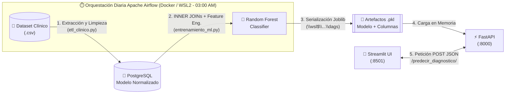
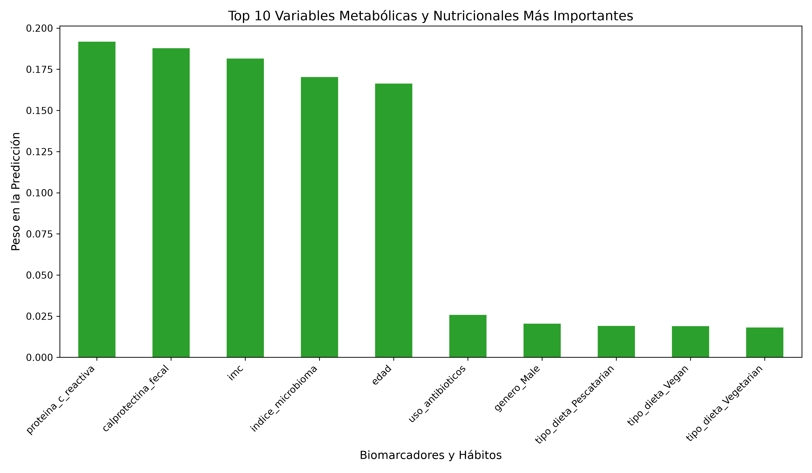
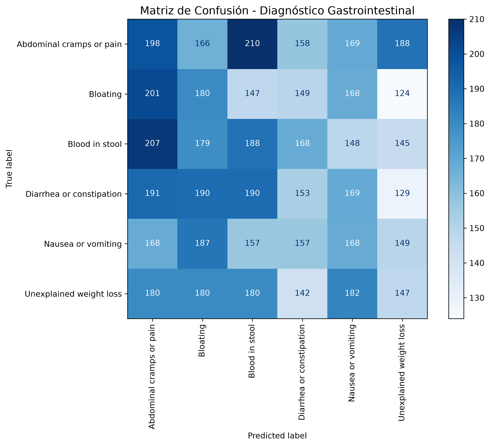

# 🩺 Sistema Predictivo de Respuesta Metabólica y Nutrición Clínica


[](./LICENSE)

Plataforma End-to-End de **Ingeniería de Datos, Machine Learning y MLOps** diseñada para predecir diagnósticos y cuadros clínicos gastrointestinales a partir de biomarcadores inflamatorios, diversidad del microbioma intestinal, métricas antropométricas y planes de nutrición clínica.

---

## 📋 Descripción del Proyecto

Este proyecto integra todo el ciclo de vida del dato clínico —desde la ingesta y normalización relacional en **PostgreSQL**, pasando por la orquestación automatizada de reentrenamiento con **Apache Airflow** en **Docker/WSL2**, hasta el despliegue de un microservicio de inferencia con **FastAPI** y un panel médico interactivo en **Streamlit**.

### Características Principales
- **Almacén de Datos Normalizado (SQL)**: Transformación de registros clínicos planos en un esquema relacional normalizado compuesto por tablas de dimensiones (`Cat_Dietas`, `Cat_Enfermedades`), entidad (`Pacientes`) y tabla central de hechos (`Registros_Clinicos`).
- **Pipeline ETL Automatizado**: Extracción resiliente a codificaciones (`latin1` / `utf8`), limpieza, resolución de llaves foráneas y carga transaccional mediante **SQLAlchemy**.
- **Orquestación MLOps Continua**: DAG programado en **Apache Airflow** (`0 3 * * *` - 03:00 AM diario) que ejecuta secuencialmente el proceso ETL, reentrena el modelo `RandomForestClassifier` y notifica al servidor API.
- **Inferencia en Tiempo Real (FastAPI + Pydantic)**: Validación estricta de rangos biológicos y alineación dinámica de vectores One-Hot Encoding (`.reindex()`) en producción.
- **Interfaz Clínica Intuitiva (Streamlit)**: Formulario médico para la captura de biomarcadores y consulta instantánea del diagnóstico previsto.

> [!NOTE]
> **Nota sobre la Estructura y Rutas del Repositorio**:  
> Esta carpeta concentra una copia unificada de los archivos que en producción operan de forma distribuida entre **Windows** (PostgreSQL, FastAPI, Streamlit) y **Linux / WSL2 con Docker** (Apache Airflow). Se conservaron intactas las rutas de red originales en el código (`\\wsl$\Ubuntu\...` y `/opt/airflow/dags/`) para reflejar con exactitud la arquitectura híbrida sin alterar el entorno de ejecución real.

---

## 🏗️ Arquitectura General del Sistema



📌 **Documentación Avanzada y Diagramas UML**:
- 📘 [**Documentación Técnica Completa (`docs/DOCUMENTACION_TECNICA.md`)**](./docs/DOCUMENTACION_TECNICA.md)
- 📊 [**Diagramas de Flujo, ERD, Secuencia y Clases UML (`docs/DIAGRAMAS_FLUJO_Y_UML.md`)**](./docs/DIAGRAMAS_FLUJO_Y_UML.md)

---

## 📂 Estructura del Repositorio

```text
Sistema_Predictivo_de_Respuesta_Metabolica_y_Nutricion_Clinica/
│
├── airflow/                                    # Entorno de Orquestación MLOps (WSL2 / Docker)
│   ├── dags/
│   │   ├── mlops_clinico_pipeline.py           # Definición del DAG en Apache Airflow
│   │   ├── etl_clinico.py                      # Script ETL hacia PostgreSQL
│   │   ├── entrenamiento_ml.py                 # Script de reentrenamiento de Random Forest
│   │   ├── columnas_entrenamiento.pkl          # Esquema serializado de features (One-Hot)
│   │   └── gastrointestinal_disease_dataset.csv# Dataset clínico fuente para el contenedor
│   └── docker-compose.yaml                     # Clúster Airflow 3.3.2 (Celery + Redis + Postgres)
│
├── docs/                                       # Documentación de Ingeniería
│   ├── DOCUMENTACION_TECNICA.md                # Especificación técnica detallada de punta a punta
│   └── DIAGRAMAS_FLUJO_Y_UML.md                # Diagramas de Arquitectura, ERD, Flujo y UML
│
├── Sistema_Predictivo_de_Respuesta_Metabolica_y_Nutricion_Clinica.sql # DDL del modelo relacional
├── script.ipynb                                # Notebook de exploración, ETL, ML y evaluación
├── api_clinica.py                              # Backend RESTful API con FastAPI y Pydantic
├── app.py                                      # Interfaz web interactiva con Streamlit
├── columnas_entrenamiento.pkl                  # Lista serializada de las 10 columnas del modelo
├── gastrointestinal_disease_dataset.csv        # Dataset clínico original (30,560 registros)
├── importancia_biomarcadores.csv               # Peso predictivo de cada variable clínica
├── reporte_metricas_clinicas.txt               # Reporte de clasificación (Precision, Recall, F1)
├── grafico_importancia_variables.png           # Visualización de importancia de biomarcadores
├── matriz_confusion_alta_calidad.png           # Matriz de confusión multiclase del modelo
├── requirements.txt                            # Dependencias de Python del proyecto
├── .gitignore                                  # Reglas de exclusión para control de versiones Git
├── LICENSE                                     # Licencia MIT del proyecto
└── README.md                                   # Documentación principal del repositorio
```

---

## 🧬 Biomarcadores y Variables Clínicas

El modelo procesa **8 variables clínicas de entrada** (que se expanden a **10 características numéricas** tras aplicar *One-Hot Encoding*):

| Variable | Tipo | Rango / Categorías | Importancia en el Modelo | Relevancia Clínica |
| :--- | :---: | :--- | :---: | :--- |
| **`proteina_c_reactiva`** | Numérica (`mg/L`) | $\ge 0.0$ | **19.17%** | Biomarcador sérico de inflamación sistémica aguda. |
| **`calprotectina_fecal`** | Numérica (`μg/g`) | $\ge 0.0$ | **18.79%** | Marcador específico de inflamación en la mucosa intestinal. |
| **`imc`** | Numérica (`kg/m²`) | $> 10.0$ | **18.16%** | Indicador antropométrico del estado nutricional y metabólico. |
| **`indice_microbioma`** | Numérica | $0.0 - 1.0$ | **17.03%** | Índice de diversidad y equilibrio de la microbiota intestinal. |
| **`edad`** | Entera (`años`) | $> 0$ | **16.63%** | Edad biológica del paciente. |
| **`uso_antibioticos`** | Booleana | `Sí` (`1`) / `No` (`0`) | **2.58%** | Factor de disbiosis inducida por tratamiento antimicrobiano reciente. |
| **`genero`** | Categórica | `Male`, `Female` | **2.04%** | Sexo biológico del paciente. |
| **`tipo_dieta`** | Categórica | `Vegan`, `Vegetarian`, `Omnivore`, `Pescatarian`, `Standard` | **5.61%** *(acumulado)* | Patrón de alimentación habitual del paciente. |

### Visualización de Resultados del Modelo

| Importancia de Biomarcadores (Random Forest) | Matriz de Confusión Multiclase |
| :---: | :---: |
|  |  |

---

## 🚀 Guía de Instalación y Ejecución

### 1. Clonar el Repositorio e Instalar Dependencias
```bash
git clone https://github.com/tu-usuario/Sistema_Predictivo_de_Respuesta_Metabolica_y_Nutricion_Clinica.git
cd Sistema_Predictivo_de_Respuesta_Metabolica_y_Nutricion_Clinica

python -m venv venv
# En Windows:
venv\Scripts\activate
# En Linux / WSL2:
# source venv/bin/activate

pip install -r requirements.txt
```

### 2. Configurar la Base de Datos en PostgreSQL
Crear la base de datos en PostgreSQL y ejecutar el archivo físico del script DDL (`Sistema_Predictivo_de_Respuesta_Metabolica_y_Nutricion_Clinica.sql`) incluido en el repositorio:
```bash
# Sintaxis general (-U: usuario, -d: nombre de la base de datos, -f: archivo .sql del repositorio):
psql -U <USERNAME> -d <DATABASENAME> -f Sistema_Predictivo_de_Respuesta_Metabolica_y_Nutricion_Clinica.sql

# Ejemplo con los valores por defecto del proyecto:
psql -U postgres -d Sistema_Predictivo_de_Respuesta_Metabolica_y_Nutricion_Clinica -f Sistema_Predictivo_de_Respuesta_Metabolica_y_Nutricion_Clinica.sql
```

### 3. Configurar Parámetros de Conexión y Rutas en los Scripts
Por seguridad y portabilidad, los archivos del repositorio utilizan marcadores genéricos. Antes de ejecutar los pipelines o levantar la API, sustituye los siguientes parámetros en el código (`airflow/dags/etl_clinico.py`, `airflow/dags/entrenamiento_ml.py`, `script.ipynb` y `api_clinica.py`):

| Parámetro | Significado y con qué sustituirlo |
| :--- | :--- |
| **`<USERNAME>`** | Coloca el **nombre de usuario de PostgreSQL** asociado a la base de datos a utilizar (por defecto suele ser `postgres`). |
| **`<PASSWORD>`** | Coloca la **contraseña** configurada para acceder a tu servidor de base de datos PostgreSQL. |
| **`<DATABASENAME>`** | Coloca el **nombre de la base de datos** creada en PostgreSQL (ej. `Sistema_Predictivo_de_Respuesta_Metabolica_y_Nutricion_Clinica`). |
| **`user`** | Coloca el **nombre del directorio del usuario** en tu sistema (WSL2/Ubuntu o Windows) que se utilizará para ejecutar y exportar los resultados (ej. en `api_clinica.py`: `\\wsl$\Ubuntu\home\user\airflow\dags` → sustituir `user` por tu usuario de Ubuntu). |

### 4. Levantar Orquestación MLOps con Apache Airflow (Docker / WSL2)
```bash
cd airflow
docker compose up -d
```
- Acceder al panel web de Airflow en `http://localhost:8080`.
- Activar el DAG **`pipeline_predictivo_metabolico`** para ejecutar el ciclo **ETL → Entrenamiento ML → Exportación `.pkl`**.
- *(Nota: El archivo `modelo_metabolico.pkl` de ~228 MB está excluido en `.gitignore` por superar el límite de 100 MB de GitHub, y se genera automáticamente al correr el DAG o `airflow/dags/entrenamiento_ml.py`).*

### 5. Iniciar el Backend API RESTful (FastAPI)
En una terminal en la raíz del proyecto:
```bash
uvicorn api_clinica:app --host 127.0.0.1 --port 8000 --reload
```
- Documentación interactiva Swagger UI disponible en: `http://127.0.0.1:8000/docs`

### 6. Iniciar la Interfaz Clínica (Streamlit)
En una segunda terminal:
```bash
streamlit run app.py
```
- La aplicación se abrirá automáticamente en el navegador en: `http://localhost:8501`

---

## 🛠️ Stack Tecnológico

- **Lenguaje Principal**: Python 3.12
- **Motor de Base de Datos**: PostgreSQL 16 + SQLAlchemy + Psycopg2
- **Orquestación de Pipelines**: Apache Airflow 3.3.2 (Docker Compose, CeleryExecutor, Redis)
- **Machine Learning y Datos**: Scikit-Learn (`RandomForestClassifier`), Pandas, Joblib, Matplotlib
- **Backend y Validación**: FastAPI, Pydantic, Uvicorn
- **Frontend Clínico**: Streamlit

---

## 📄 Licencia

Este proyecto está distribuido bajo la **Licencia MIT**. Consulta el archivo [`LICENSE`](./LICENSE) para más detalles.

© 2026 **Roberto Alejandro Chagra Martinez** — Todos los derechos reservados bajo los términos de la licencia MIT.
