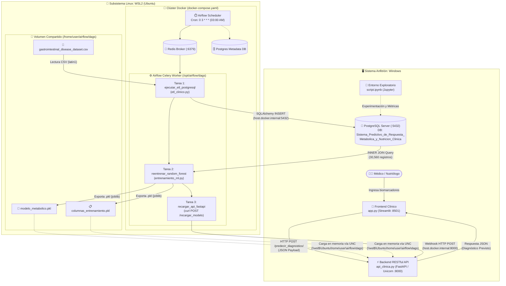
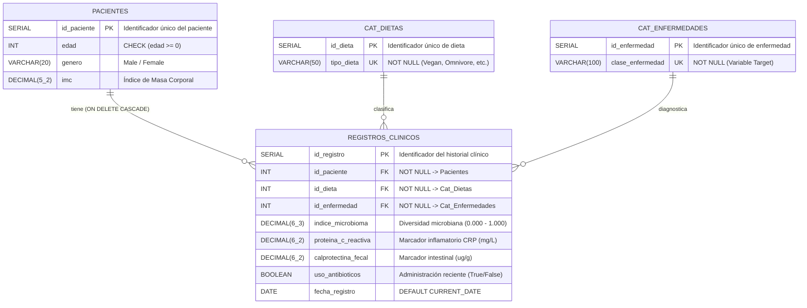
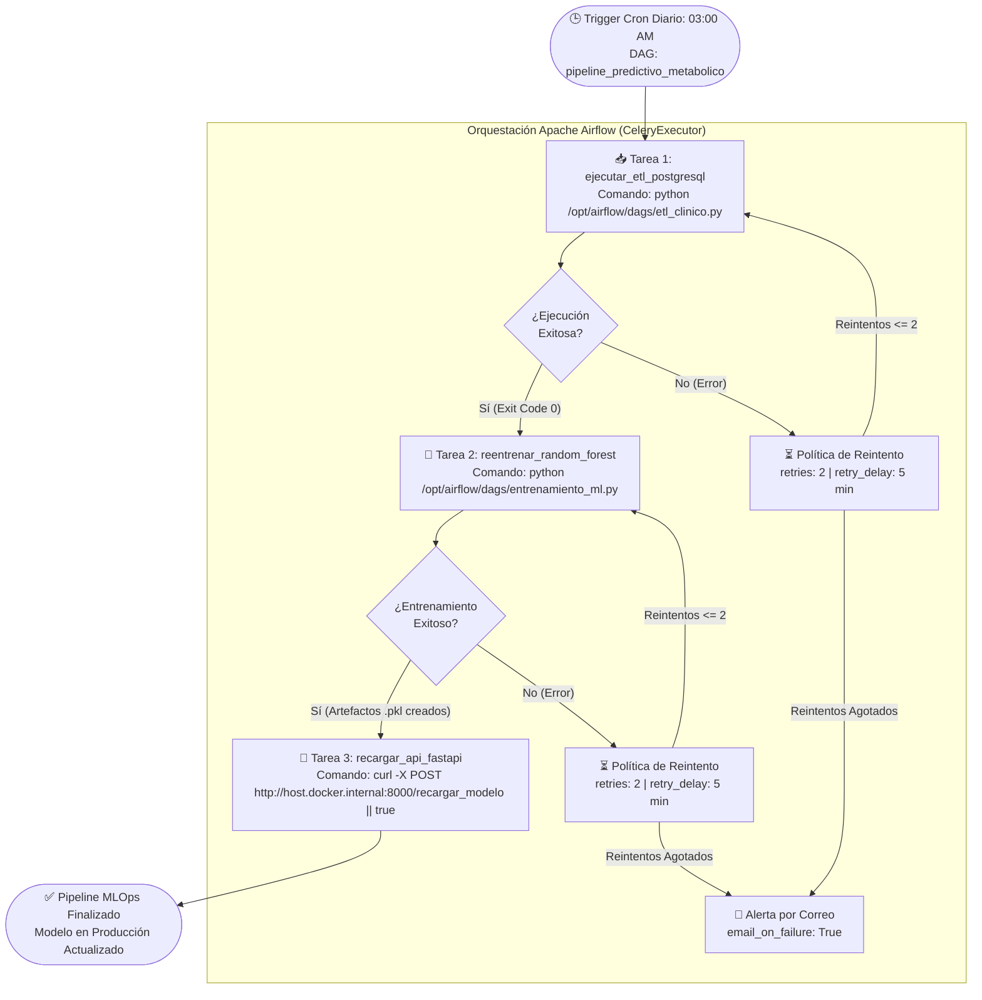
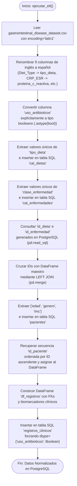
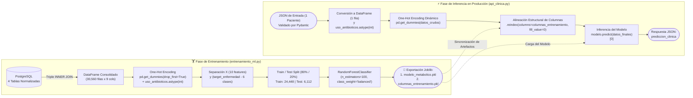
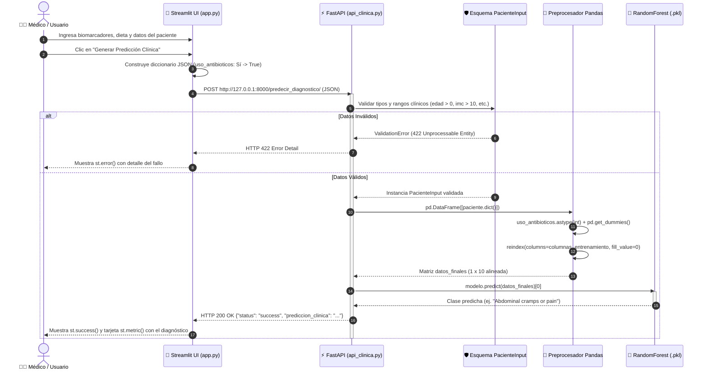
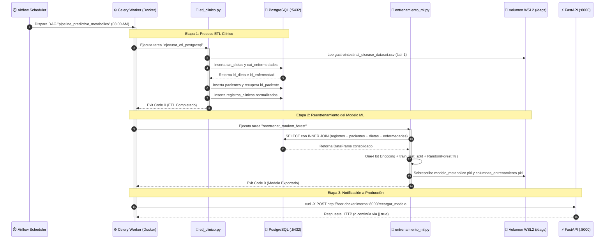
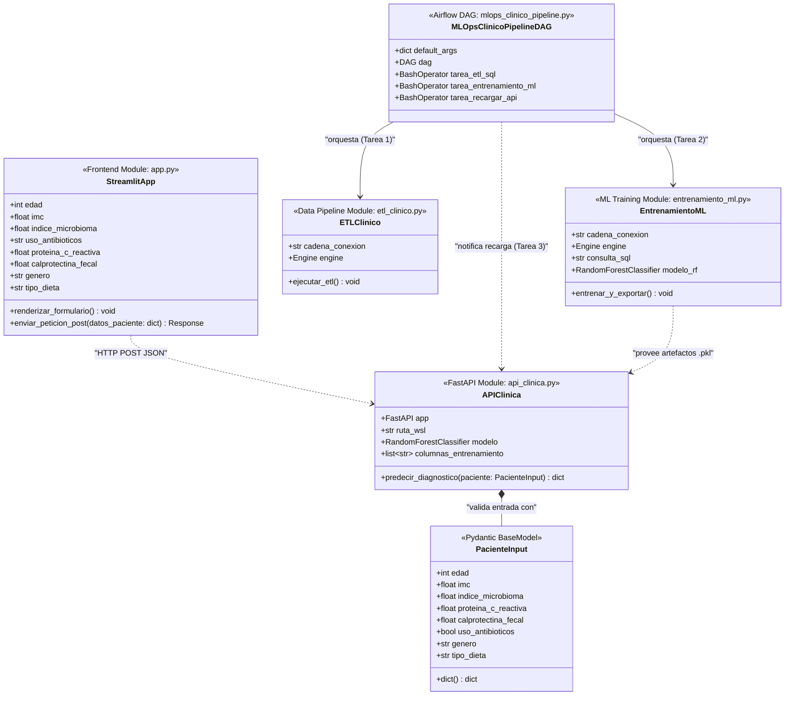
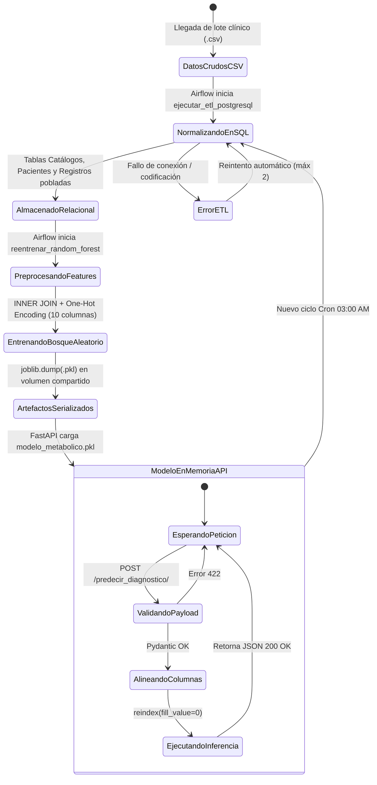

# 📊 Diagramas de Flujo, Arquitectura y UML

Este documento contiene la representación visual completa del **Sistema Predictivo de Respuesta Metabólica y Nutrición Clínica** utilizando sintaxis **Mermaid** (compatible de forma nativa con el renderizador de GitHub).

---

## Índice de Diagramas
1. [Diagrama de Arquitectura e Infraestructura Híbrida (Componentes y Despliegue)](#1-diagrama-de-arquitectura-e-infraestructura-híbrida-componentes-y-despliegue)
2. [Diagrama Entidad-Relación (ERD - Base de Datos PostgreSQL)](#2-diagrama-entidad-relación-erd---base-de-datos-postgresql)
3. [Diagrama de Flujo del Pipeline MLOps (Orquestación en Apache Airflow)](#3-diagrama-de-flujo-del-pipeline-mlops-orquestación-en-apache-airflow)
4. [Diagrama de Flujo Detallado del Proceso ETL (`etl_clinico.py`)](#4-diagrama-de-flujo-detallado-del-proceso-etl-etl_clinicopy)
5. [Diagrama de Flujo de Entrenamiento e Inferencia ML](#5-diagrama-de-flujo-de-entrenamiento-e-inferencia-ml)
6. [Diagrama de Secuencia UML: Inferencia Clínica en Tiempo Real](#6-diagrama-de-secuencia-uml-inferencia-clínica-en-tiempo-real)
7. [Diagrama de Secuencia UML: Ciclo Automatizado MLOps Nocturno](#7-diagrama-de-secuencia-uml-ciclo-automatizado-mlops-nocturno)
8. [Diagrama de Clases y Módulos UML](#8-diagrama-de-clases-y-módulos-uml)
9. [Diagrama de Estados UML: Ciclo de Vida del Modelo Predictivo](#9-diagrama-de-estados-uml-ciclo-de-vida-del-modelo-predictivo)

---

## 1. Diagrama de Arquitectura e Infraestructura Híbrida (Componentes y Despliegue)

Representa la topología física y lógica del sistema distribuido entre **Windows Host**, **WSL2 (Ubuntu)** y **Docker Engine**.

> [!NOTE]
> **Nota de configuración**: En el diagrama anterior, `user` representa el nombre del directorio del usuario dentro de WSL2 (`Ubuntu`) donde se monta el volumen de ejecución y exportación de resultados (`/home/user/airflow/dags`).

---

## 2. Diagrama Entidad-Relación (ERD - Base de Datos PostgreSQL)

Modelo relacional en Estrella / 3ra Forma Normal implementado en `Database/Sistema_Predictivo_de_Respuesta_Metabolica_y_Nutricion_Clinica.sql`.

---

## 3. Diagrama de Flujo del Pipeline MLOps (Orquestación en Apache Airflow)

Representa la lógica de control, programación y tolerancia a fallos definida en `Para_Linux/airflow/dags/mlops_clinico_pipeline.py`.

---

## 4. Diagrama de Flujo Detallado del Proceso ETL (`etl_clinico.py`)

Describe paso a paso la transformación desde el archivo CSV crudo hasta las tablas relacionales en PostgreSQL.

---

## 5. Diagrama de Flujo de Entrenamiento e Inferencia ML

Muestra cómo se procesan las características tanto en la fase de entrenamiento (`entrenamiento_ml.py`) como en la fase de inferencia (`api_clinica.py`), garantizando consistencia dimensional.

---

## 6. Diagrama de Secuencia UML: Inferencia Clínica en Tiempo Real

Detalla el intercambio de mensajes síncronos cuando un profesional de la salud solicita una predicción desde la interfaz web.

---

## 7. Diagrama de Secuencia UML: Ciclo Automatizado MLOps Nocturno

Detalla la interacción desatendida entre los servicios de Airflow en Docker, la base de datos PostgreSQL y la API de producción.

---

## 8. Diagrama de Clases y Módulos UML

Estructura orientada a objetos y modular de los scripts que conforman el sistema.

---

## 9. Diagrama de Estados UML: Ciclo de Vida del Modelo Predictivo

Representa las transiciones de estado por las que atraviesan los datos y el modelo dentro del flujo continuo MLOps.

